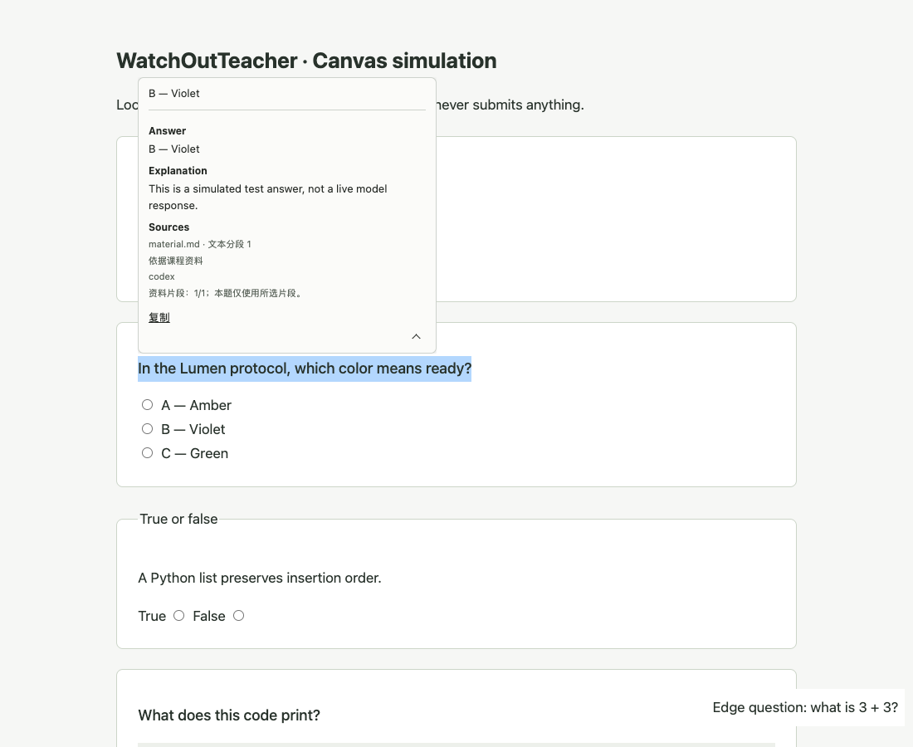

<p align="center">
  
</p>

<h1 align="center">WatchOutTeacher</h1>
<p align="center">Created by Blue</p>
<p align="center"><strong>中文</strong> · <a href="README.en.md">English</a></p>

<p align="center">
  <a href="https://github.com/Blue4u0610/WatchOutTeacher/releases/latest"></a>
  <a href="https://github.com/Blue4u0610/WatchOutTeacher/actions/workflows/test.yml"></a>
</p>

按住 **Alt（Windows）或 Option ⌥（macOS）** 划选网页上的问题，答案就出现在旁边。需要解释和出处时，点右下角的 **⌄**；需要复制时，直接选中文字。

WatchOutTeacher 是一个运行在 **Windows / macOS + Chrome / Edge / Chromium** 上的课程辅助扩展，通过本机 **Codex CLI**、**Claude Code** 或 **Gemini（Antigravity CLI）** 回答问题。可以导入自己的课件，让回答参考当前课程资料。它不会替你点击选项或提交作业——鼠标的最后一票，还是你的。

Star my repo pls, this is important./点个star吧 这很重要

Email:bluelan0610@outlook.com

[安装](#安装从零开始) · [使用](#日常使用) · [资料与隐私](#资料怎么用数据去哪儿) · [排障](#遇到问题) · [开发](#开发与测试)

[下载最新版本](https://github.com/Blue4u0610/WatchOutTeacher/releases/latest) · [版本历史](docs/VERSIONS.md) · [更新日志](CHANGELOG.md)

正式版本提供带版本号的源码包和 SHA-256 校验值。Windows / macOS 使用同一个包，按各自指南安装；`main` 分支是开发中的代码。

## 能做什么

- **原地问答**：划选后显示答案，滚动页面也会保留；解释单独展开，文字可以复制。
- **按课程查资料**：导入 PDF、PPTX、TXT、Markdown；引用标明文件及页码、幻灯片或文本片段。
- **自己选模型和强度**：Codex 模型列表由本机 CLI 提供，支持自动或手动推理强度。
- **可选备用服务**：首选失败后按顺序尝试勾选的服务，也可以关闭备用。升级不会自动启用 Gemini。
- **按需授权网站**：从一个课程网站开始，或自行开启所有 HTTP / HTTPS 网站。

<details>
<summary>看一眼界面</summary>



这是仓库自带的演示题，答案来自测试替身，用于展示界面。真实 Codex 调用记录与覆盖范围见 [测试说明](docs/TESTING.md)。

</details>

## 安装：从零开始

选择你的系统，完成对应指南的 **第 1–4 步**，然后继续下方第 5 步。

| 系统 | 安装入口 | 提问快捷键 |
| --- | --- | --- |
| Windows 11（原生环境） | [Windows：PowerShell 安装指南](docs/INSTALL.windows.md) | 左 Alt + 鼠标拖选 |
| macOS | [macOS：终端安装指南](docs/INSTALL.macos.md) | Option ⌥ + 鼠标拖选 |

两个系统都从 **安装并登录 Codex CLI、Claude Code 或 Gemini（Antigravity CLI）** 开始，再安装 Python、下载项目和注册本地桥接。仅安装 ChatGPT / Claude 桌面应用还不够。Windows 的三个服务均使用原生 CLI 安装器；只装在 WSL 里的 CLI 不会被本插件调用。

这是本机扩展，不需要租服务器。Safari / Firefox 暂不支持，插件界面目前为中文。自动测试覆盖 macOS 与 Windows；真实 AI 账户调用的验证范围见[测试说明](docs/TESTING.md)。

### 5. 加载扩展

1. Chrome 打开 `chrome://extensions`；Edge 打开 `edge://extensions`。
2. 开启右上角的 **开发者模式**。
3. 点击 **加载已解压的扩展程序**。
4. 选择项目里的 **`extension` 子文件夹**。
5. 将 WatchOutTeacher 固定到工具栏，点击图标打开设置。

**选 `extension`，不要选项目根目录。** 如果看到 `Manifest file is missing or unreadable`，通常就是选错了这一层。

### 6. 授权网站、选择服务

1. 设置页应显示“本地桥接已连接”。
2. 输入课程网站，例如 `https://school.instructure.com`，点击授权并接受浏览器提示。也可选择“授权所有网站”。
3. 点击 **检测 CLI**，确认准备使用的工具已安装并登录。
4. 选择首选服务、模型和 Codex 推理强度，点击 **保存设置**。只有一个 CLI 时，可以关闭备用服务。
5. 刷新要使用的网页。Chrome 内部页、扩展商店等受保护页面不支持。

安装检测不会生成答案，也不代表账户一定还有额度。下一步用一个小问题检查实际调用。

macOS 上也会检测 Claude 桌面应用内置的 Claude Code。桌面应用登录与 CLI 认证可能不同；在“检测 CLI”里确认登录状态，未登录时需在终端运行检测结果中的可执行文件并加上 `auth login`。

### 7. 试一道题，再导入课件

在获授权的网页上，按住 **左 Alt（Windows）或 Option ⌥（macOS）**，从文字处按下鼠标左键并拖选题干和选项。松开后，等待答案出现。

想先用固定示例？在项目目录运行：

**Windows（PowerShell）：**

```powershell
py -3.12 -m http.server 8765 --bind 127.0.0.1 --directory tests
```

**macOS（终端）：**

```sh
python3 -m http.server 8765 --bind 127.0.0.1 --directory tests
```

授权 `http://localhost:8765`，打开 [本地演示页](http://localhost:8765/fixture.html)，划选第一道 `2 + 2`。**这会实际调用你的 CLI，使用对应账户的额度。** 测完按 `Ctrl+C` 关闭演示服务器；日常使用不需要它。

然后在设置页创建课程，把 PDF、PPTX、TXT 或 MD 文件拖入资料区（支持多个），或点击选择文件，等到显示“已导入”。可以先导入仓库里的 `tests/material.md`，再划选演示页第二题；资料把虚构 Lumen 协议的就绪颜色定义为 Violet，引用应指向这份文件。

从 Zotero 批量拖入后，请核对资料区显示的“本批收到”数量。若少于 Zotero 中选中的附件数量，先把附件拖到 Finder／资源管理器的文件夹，再从那里批量拖入。插件会列出浏览器实际传来的每份文件及导入结果；正在导入时也可以继续追加。

## 日常使用

| 想做什么 | 怎么操作 |
| --- | --- |
| 提问 | Windows 按住左 Alt，macOS 按住 Option ⌥，左键拖选；普通划词不会提问 |
| 看解释、出处 | 点击答案框右下角 ⌄；再点一次收起 |
| 复制答案 | 直接选中文字，Windows 按 Ctrl+C，macOS 按 ⌘C；展开后也有“复制”按钮 |
| 滚动、缩放 | 答案保留，并重新定位到可见区域 |
| 关闭答案 | 左键点击浮层外，并取消或替换原选区 |
| 换一道题 | 再次 Alt / Option 拖选；旧请求会取消 |
| 快捷键冲突 | 设置中改为 Alt + Shift / Option + Shift |
| 换课程 | 在设置页切换；新问题使用新课程的资料 |

右键、中键和 Esc 不关闭浮层。页面跳转、刷新、原文字节点被移除或课程变更，会清理旧答案。

### 模型与推理强度

模型和强度在 **本插件设置** 中选择，保存后对下一题生效。更改某个 Codex 聊天窗口的模型不会影响插件。

- **自动**：不指定强度，交给 CLI / 服务默认处理。
- **手动**：显示所选模型支持的普通档位，例如 Low、Medium、High、XHigh、Max，并明确传给 CLI。
- **自定义模型**：可以填完整模型 ID；实际支持情况由 CLI 校验。

更高强度通常更慢、消耗更多，也不保证每题更准。Ultra 涉及自动任务分派，本插件暂不提供。Claude 使用默认强度。Gemini 通过 Antigravity CLI 1.4.2 调用，模型列表来自当前账户，High / Medium / Low 随模型选项选择；自动模式取账户列表中的第一个 Gemini 模型。模型列表会变化，点击“刷新模型列表”即可更新，不需要照抄 README 里的旧名单。

### 回答要求（提示词）

在设置页 **「模型和操作 → 回答要求」** 中填写并保存，后续每道题都会使用。可以指定语言、长度、表达方式和资料使用要求，最多 2,000 字；同一套要求适用于所有课程、首选和备用服务。点击「恢复默认回答要求」后再保存即可恢复，留空保存也会恢复默认。

默认要求是：优先参考相关 PPT／PDF 等资料，用自己的话概括，引用必须有依据；当前检索到的片段不足时明确说明，补充通用知识时单独标明，无法可靠判断时说明需要补充什么信息。不会把“部分片段未找到”说成“所有文件都没有”。

提示词保存在本机，并随每道题发给所选 AI 服务，不写入诊断日志。它能引导回答，但不能保证模型永不出错，仍需核对资料与引用。

## 资料怎么用，数据去哪儿

```text
网页选区 + 当前题目
        ↓
本机课程索引 → 取出相关片段
        ↓
Codex CLI / Claude Code / Gemini（Antigravity CLI） → 对应 AI 服务
        ↓
答案 + 解释 + 来源 → 网页浮层
```

导入时，文件解析成文本并存入本机 SQLite。每道题最多检索 **12 个片段**发送给模型；不会每题重新打开所有原文件，也不是把整门课训练进模型。每题是独立会话。

| 文件 | 能读取的内容 | 需要注意 |
| --- | --- | --- |
| PDF | 可提取文本、文件页码 | 扫描件先做 OCR；加密 PDF 不支持 |
| PPTX | 文字框、组合文字、表格 | 不读取图片、图表含义和演讲者备注 |
| TXT / Markdown | UTF-8 文本 | 来源是文本片段编号，不是行号 |

单个文件上限 **100 MB**。旧 `.ppt`、Word、图片和自动截图目前不支持。关键词检索对同义词、中文分词和跨语言问题有限；没有命中时会提示回退到开头片段。引用说明“提供过哪份材料”，不等于推论一定正确。

课程索引保存在本机：

- Windows：`%LOCALAPPDATA%\WatchOutTeacher\courses.sqlite3`
- macOS：`~/Library/Application Support/CourseAssist/courses.sqlite3`（沿用旧目录以兼容已有安装）

选区、题目上下文和检索片段会经 CLI 发往所选 AI 服务，因此**不是离线问答**。删除资料会删除本地索引，不会删除原文件。

桥接默认不保存题目和答案正文日志。Antigravity CLI 会保留本地会话记录。为避免执行个人自定义操作，当前适配器遇到全局 Hooks、MCP、插件或规则时拒绝调用。各服务端的数据保留规则以对应账户条款为准。诊断只记录服务、请求的模型与强度、错误类别、用时及检索数量。模型权限、订阅额度和服务费用以 CLI 所登录账户为准。

## 更新与卸载

**Git 安装：** 先关闭题目页和设置页，在扩展管理页禁用 WatchOutTeacher，然后在项目目录运行：

**Windows：**

```powershell
git pull --ff-only
py -3.12 scripts/install.py
```

**macOS：**

```sh
git pull --ff-only
python3 scripts/install.py
```

重新启用扩展，点击 **重新加载**，再刷新题目页。ZIP 安装则下载新版并替换源码；若移动了文件夹，需要重新加载新的 `extension` 路径。不要删除已经加载的源码文件夹。

**卸载：**

Windows：`py -3.12 scripts/install.py --uninstall`；macOS：`python3 scripts/install.py --uninstall`。

再从浏览器移除扩展。课程资料默认保留；如需一并移除，退出浏览器后删除上述系统对应的数据文件夹。Windows 安装器只注册当前用户，不需要管理员权限。

## 遇到问题

| 现象 | 先检查这里 |
| --- | --- |
| 找不到 manifest | 加载的是项目里的 `extension` 文件夹吗？ |
| 找不到本地宿主 / 宿主退出 | 按对应系统重新运行安装器，再重新加载扩展；Windows 确认使用原生 Python，macOS 保持安装器生成的运行路径 |
| 桥接连接断开 | 设置页点“重连 / 刷新资料”，刷新题目页再划选 |
| 划词没反应 | 网站授权、页面刷新、鼠标按下前按住 Alt / Option；输入框内不触发，选区最多 8,000 字符 |
| Canvas 内层题目没反应 | 题目可能来自另一个 iframe 域名；授权该域名，或自行选择所有网站授权 |
| 认证或额度错误 | 终端运行 `codex login status`，或打开 `claude` / `gemini` 检查登录及账户提示 |
| Windows 检测不到 CLI | 三个服务均使用原生安装器；Gemini 需确认 agy 1.4.2 可运行，然后重启浏览器。不调用 WSL |
| CLI 参数不兼容 | 更新 CLI 后重新检测；[已验证环境](docs/TESTING.md) 列出版本 |
| 回答缺少选项或公式 | 补选完整题目；图片与不可提取公式目前不会传给模型 |
| 资料没有被引用 | 检查导入警告、当前课程和本题检索数量；资料不足时可能使用通用知识 |
| 想在 Safari 用 | 目前没有 Safari 安装包；见 [移植说明](docs/SAFARI.md) |

## 开发与测试

运行需要 Python；浏览器测试另外需要 **Node.js 22+**。测试使用临时浏览器配置和测试课程，不读取日常浏览器账户。

Windows 先运行 `py -3.12 -m venv .venv`；macOS 运行 `python3 -m venv .venv`。接下来两边相同：

```sh
node scripts/python.mjs -m pip install -r requirements.txt
npm ci
npx playwright install chromium
npm test
npm run test:browser
```

真实模型测试需先登录 Codex，并会使用账户额度：

```sh
npm run test:live
```

[架构](docs/ARCHITECTURE.md) · [测试说明](docs/TESTING.md) · [版本记录](CHANGELOG.md) · [贡献指南](CONTRIBUTING.md)

本项目用于课程阅读与复习，请遵守课程对 AI 的使用要求。它与 OpenAI、Anthropic、Google、Canvas 没有隶属关系。
